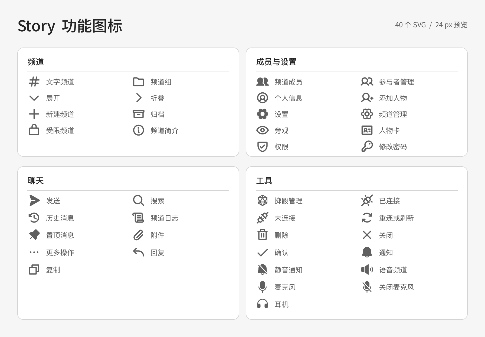

# Story 功能图标

## Discord 设计参考

- **双人剪影**用前后错开的两个人物表示成员列表，位于桌面聊天的频道标题栏右侧。Story 的「频道成员」和「参与者管理」可以沿用这个图形语义。[Discord 成员列表说明](https://support.discord.com/hc/en-us/articles/223657667-Group-Chat-and-Calls)
- **齿轮**用于个人设置，也出现在有权限编辑的频道旁。图形相同，由所在位置提示设置对象。[Discord 个人设置](https://support.discord.com/hc/en-us/articles/38859942749463-Profile-Privacy-Setting-on-Discord) · [Discord 文字频道](https://support.discord.com/hc/en-us/articles/4412085582359-Text-Channels-Text-Chat-In-Voice-Channels)
- **井号**放在文字频道名称前，**扬声器**区分语音频道。频道栏用弱化的单色图标，聊天顶部的图钉与成员剪影更醒目。[Discord 频道栏截图](https://support.discord.com/hc/article_attachments/21170418255383) · [Discord 置顶消息](https://support.discord.com/hc/en-us/articles/221421867-Pin-Messages-FAQ)

## 来源与许可

- `phosphor/` 含 39 个上游原版 SVG，取自 `@phosphor-icons/core` 2.1.1，使用 MIT 许可，随附[原始许可文本](phosphor/LICENSE)。[Phosphor 上游仓库](https://github.com/phosphor-icons/core) · [2.1.1 发布包](https://www.npmjs.com/package/@phosphor-icons/core/v/2.1.1)
- `story/dice-d20.svg` 为本项目绘制，用在「掷骰管理」或掷骰入口。它沿用同一套 256 × 256 的 SVG 坐标网格。

## 功能与文件

Phosphor 的文件分布在 `phosphor/bold/` 和 `phosphor/fill/` 中，按文件末尾的 `-bold` 或 `-fill` 定位。成员和设置备有两种线型，实心适合标题栏，粗线适合带文字的入口。其余图标按下表的功能选用。

| 位置 | 功能 | SVG 文件 |
| --- | --- | --- |
| 频道 | 文字频道或大厅 | `hash-bold.svg` |
| 频道 | 频道组 | `folder-simple-bold.svg` |
| 频道 | 展开或折叠 | `caret-down-bold.svg` · `caret-right-bold.svg` |
| 频道 | 新建频道或频道组 | `plus-bold.svg` |
| 频道 | 归档频道 | `archive-bold.svg` |
| 频道 | 受限频道 | `lock-simple-bold.svg` |
| 频道 | 频道简介 | `info-bold.svg` |
| 成员与设置 | 频道成员、参与者管理 | `users-fill.svg` · `users-bold.svg` |
| 成员与设置 | 个人信息 | `user-circle-bold.svg` |
| 成员与设置 | 添加人物 | `user-plus-bold.svg` |
| 成员与设置 | 频道管理、设置 | `gear-six-fill.svg` · `gear-six-bold.svg` |
| 成员与设置 | OB 旁观身份 | `eye-bold.svg` |
| 成员与设置 | 人物卡或个人属性 | `identification-card-bold.svg` |
| 成员与设置 | 权限 | `shield-check-bold.svg` |
| 成员与设置 | 修改密码 | `key-bold.svg` |
| 聊天 | 发送消息 | `paper-plane-right-fill.svg` |
| 聊天 | 搜索 | `magnifying-glass-bold.svg` |
| 聊天 | 查看历史消息 | `clock-counter-clockwise-bold.svg` |
| 聊天 | 频道日志或完整聊天记录 | `scroll-bold.svg` |
| 聊天 | 置顶消息 | `push-pin-fill.svg` |
| 聊天 | 附件 | `paperclip-bold.svg` |
| 聊天 | 更多操作 | `dots-three-bold.svg` |
| 聊天 | 回复 | `arrow-bend-up-left-bold.svg` |
| 聊天 | 复制连接地址或文本 | `copy-bold.svg` |
| 工具 | 掷骰管理 | `story/dice-d20.svg` |
| 工具 | 已连接或未连接 | `plugs-connected-bold.svg` · `plugs-bold.svg` |
| 工具 | 重连或刷新 | `arrows-clockwise-bold.svg` |
| 工具 | 删除 | `trash-bold.svg` |
| 工具 | 关闭或确认 | `x-bold.svg` · `check-bold.svg` |
| 工具 | 通知或静音通知 | `bell-fill.svg` · `bell-slash-fill.svg` |
| 工具 | 语音频道 | `speaker-high-fill.svg` |
| 工具 | 麦克风开启或关闭 | `microphone-fill.svg` · `microphone-slash-fill.svg` |
| 工具 | 耳机 | `headphones-fill.svg` |

Qt 可使用 `QSvgRenderer` 加载这些 SVG。需要随主题着色时，渲染前在内存中将 `currentColor` 替换为对应的颜色。预览采用 24 px 图标，侧栏和工具栏可按密度选用 16–24 px。表中的语音、置顶等条目也可以作为后续功能的素材。
